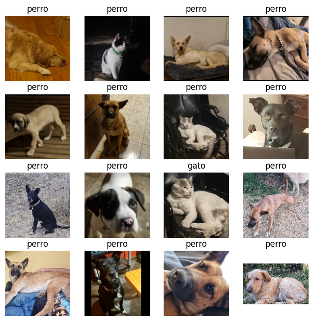

# Clasificación de perros y gatos con transfer learning

**Origen:** capstone grupal del módulo 7 de Deep Learning, `07/CAPSTONE/G7_DL_Proyecto_Transfer_Learning.ipynb`. Keber participó en el trabajo completo junto con el equipo; este caso se presenta como trabajo colaborativo.

## Problema y enfoque

El equipo adaptó InceptionV3 preentrenada en ImageNet para clasificar fotografías de gatos y perros. Usó 1.000 imágenes de cada clase para entrenar una nueva cabeza de clasificación sobre la base congelada. Después descongeló las últimas 30 capas y realizó cinco épocas adicionales con una tasa de aprendizaje de `1e-5`. La comparación permite examinar qué cambió al ajustar parte del extractor de características, además de la cabeza.

## Evidencia conservada

El notebook registra una evaluación adicional sobre 2.000 imágenes (1.000 por clase) tomadas de la misma colección de entrenamiento, pero excluidas de las 2.000 imágenes elegidas para ajustar los modelos. En esa evaluación, el generador mantuvo el orden de las imágenes (`shuffle=False`), de modo que las predicciones y etiquetas se pudieron emparejar para construir las matrices de confusión.

| Modelo | Gatos correctos | Gatos clasificados como perros | Perros clasificados como gatos | Perros correctos | Exactitud calculada |
| --- | ---: | ---: | ---: | ---: | ---: |
| Base congelada + clasificador | 883 | 117 | 46 | 954 | 91,85 % |
| Ajuste fino de las últimas 30 capas | 921 | 79 | 55 | 945 | 93,30 % |

El ajuste fino sumó 29 aciertos netos sobre esas 2.000 imágenes. Mejoró la identificación de gatos, aunque aumentó de 46 a 55 la cantidad de perros clasificados como gatos. Estas cifras proceden de las matrices guardadas en el notebook; no se han reproducido mediante un nuevo entrenamiento.

## Imágenes del cierre

El equipo probó ambos modelos sobre 16 fotografías personales ajenas al conjunto usado para entrenar. Las siguientes composiciones se extrajeron de las salidas guardadas en el cierre del notebook. El texto sobre cada foto es la **clase predicha**, no una etiqueta de referencia. En la segunda fila, tercera columna, el modelo inicial predijo «perro» para un gato y el modelo ajustado predijo «gato». En la primera fila, segunda columna, ambos predijeron «perro» para otro gato.

**Modelo inicial**

**Modelo con ajuste fino**

## Límites que acompañan el resultado

- El conjunto de 40 imágenes llamado *test* se usó durante el entrenamiento como `validation_data`. Por eso, las exactitudes de 87,5 % y 92,5 % registradas allí no representan una prueba independiente posterior al ajuste.
- El generador de ese conjunto tenía `shuffle=True`. Sus matrices de confusión compararon predicciones con etiquetas en orden fijo y no permiten interpretar los errores por clase. Para el portafolio se usan las matrices de la evaluación adicional, cuyo generador tenía `shuffle=False`.
- Las 2.000 imágenes de la evaluación adicional proceden de la misma colección que el conjunto de entrenamiento. Están excluidas del subconjunto elegido para entrenar en el código, pero el notebook no documenta una partición externa ni una semilla que permita reconstruir exactamente la selección.
- El código aplica `rescale=1./255` a las imágenes. La [documentación oficial de Keras para InceptionV3](https://keras.io/api/applications/inceptionv3/inception_v3_preprocessing/) indica usar `preprocess_input`, que escala los píxeles a `[-1, 1]`. Una revisión futura debería corregir ese preprocesamiento y volver a medir; los resultados anteriores describen la ejecución histórica.
- Las fotos personales del cierre del notebook sirven como exploración cualitativa, sin un archivo de etiquetas de referencia verificadas ni tamaño suficiente para una métrica.

## Presentación propuesta

Este caso puede mostrar selección de una red preentrenada, construcción de una cabeza binaria, aumento de datos, ajuste fino y lectura crítica de matrices de confusión. El artefacto principal es esta ficha con las composiciones visuales del cierre; una curaduría posterior podría añadir fragmentos de código y una figura de las dos matrices. Las fotografías originales por separado, el notebook grupal completo y los archivos `.keras` permanecen fuera de la carpeta de portafolio. No se ofrece una demo ni se afirma que los modelos actuales estén listos para producción.
